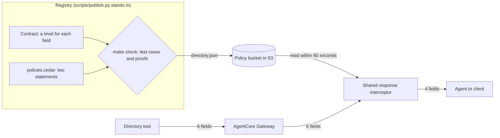
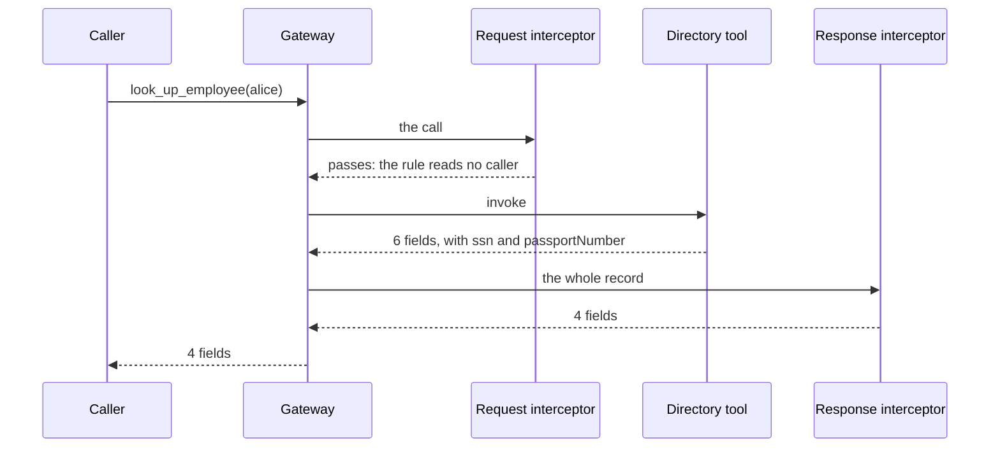
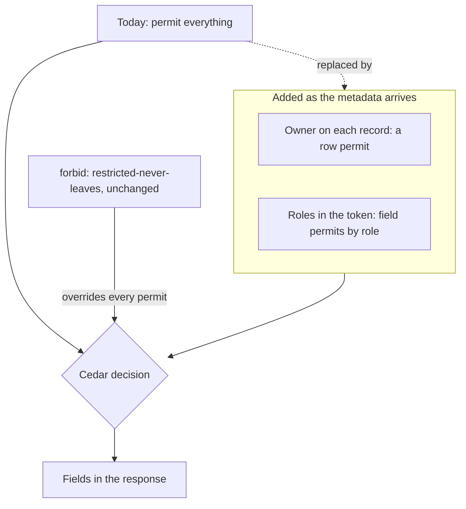

# The restricted field filter

November 6, 2026.  The smallest response filter the plumbing supports: two
Cedar statements, published through the registry to the shared interceptor,
that stop a field labelled `restricted` from leaving an MCP tool response,
whoever calls.  It reads no caller, no role, and no record, so it needs none
of the metadata the ownership and role use cases are waiting on.

It runs as target `directory` on `AppliedOdcsShared`, beside `hr/`, on the same
Gateway and the same interceptor Lambda.  `make demo-directory` shows everything
below against the deployed stack in about three minutes.

## The path from the contract to the response



A label changed in the contract reaches the response with no deploy and no
change to the tool or the interceptor.  The interceptor code holds nothing about
the directory: this target is one more policy file.

## One lookup through both interceptors



| Field | Label in the contract | Reaches Alice | Reaches Bob |
| --- | --- | --- | --- |
| `employeeId`, `name`, `workEmail` | `public` | yes | yes |
| `personalPhone` | `internal` | yes | yes |
| `ssn` | `restricted` | no | no |
| `passportNumber` | none: the tool returns it and the contract does not declare it | no | no |

## The whole policy

```cedar
@id("everything-else-passes")
permit(principal, action, resource);

@id("restricted-never-leaves")
forbid(principal, action == Action::"ReadEmployeeField", resource)
unless {
  context has field &&
  Contract::"Employee".hasTag(context.field) &&
  Contract::"Employee".getTag(context.field) != "restricted"
};
```

A tool needs three pieces of metadata to be filtered this way: a level for each
field it returns, an id field for its record, and a binding of the tool to its
model.  A record with no id field comes back as an empty object.

## Live results

From `make demo-directory` and `make publish` on cedar-odcs v0.2.10.

| Step | Result |
| --- | --- |
| Alice looks up Alice | 200.  4 fields.  The tool's log shows it returned 6, with `ssn` and `passportNumber` |
| Bob looks up Alice | The response is identical |
| The tool fails on an id it does not know | 200 with `isError`: `the tool call failed; its error message is withheld`.  The raw failure held the id, the error message, and a stack trace |
| Proofs on the policy | 4 proved, 0 failed |
| A later permit opens every field | `ssn` is still cut.  5 proved, 0 failed |
| Carol is exempted from the forbid | All 9 test cases still pass.  2 proofs fail.  `make publish` exits 2 and the S3 ETag does not change |
| The forbid is deleted | The test cases fail first.  `make publish` exits 2 and the S3 ETag does not change.  The filter, run with that file, returns `ssn` |
| `personalPhone` is relabelled `restricted` and published | Gone from the response after 65 seconds, with no deploy |
| The label is restored and published | Back after 65 seconds |
| `make demo` for `hr/` on the same Lambda | Unchanged: the same results and refusal messages as before, and the `hr.json` ETag did not move |

The Carol row is the case for the proofs.  Her exemption is a real hole, and no
test case names her.  The proofs hold for every caller, every record, and every
set of labels, so they find it.

## Policies that replace the blanket permit



| Metadata that arrives | Statement that changes | Where it runs today |
| --- | --- | --- |
| The caller in the token and the owner of each record | The blanket permit becomes a permit comparing the two | `hr/`, on this Gateway and Lambda |
| Roles in the token | Field permits by role | Branch `hr-full` |
| An agent acting for a person | Permits that read the acting party | Branch `hr-full` |

The forbid and its two guardrails do not change at any of these steps.  What is
missing today is permits.  The boundary does not depend on them, and `make check`
reproves it each time one is added.

## Cases the filter covers

| Case | Result | Shown by |
| --- | --- | --- |
| A restricted field in a text result | Cut | Live |
| A field the contract does not declare | Cut | Live.  The recordings show the Gateway does not hold a result to the tool's `outputSchema` |
| A tool failure reported in the result, with its stack trace | Replaced with a fixed message | Live |
| A refusal by the request interceptor | Keeps its words, which are worked out again from the request | Live.  The Gateway runs the response interceptor on a refusal too |
| A restricted field in `structuredContent` | Cut | Replay |
| A restricted name nested under an undeclared object or list | Cut | Replay |
| Text that is not a JSON record | Withheld | Replay |
| Non-text content items, such as an embedded resource | Left out | Replay |
| Other keys of the result or the JSON-RPC body, such as `_meta` | Left out | Replay |
| A JSON-RPC `error` from a target | Replaced with a fixed message | Replay |
| A policy file missing or unreadable on first use | Withheld | Replay |

The replay rows use hand-built Gateway events.  A Lambda function target cannot
send those shapes, because the Gateway wraps its return value in one text item,
so they have not been seen from a live target.

## Cases outside the filter

- **A value inside a labelled field.**  The filter reads labels and never looks
  at values.  A tool that writes an SSN into `name` sends it.  A test pins this.
- **A wrong label.**  The proofs hold for every set of labels and say nothing
  about whether the published labels are correct.
- **The code around the decision.**  The proofs cover the Cedar decision.  The
  handlers that build the request and rewrite the response are covered by tests
  and live recordings.
- **Rows and roles.**  Every caller sees every record, and every field below
  `restricted`.  That is the point of this example and not a design for a tool
  with owned records.
- **Writes.**  The blanket permit passes every write, so this example has one
  read tool.
- **A tool called around the Gateway.**  The boundary is the Gateway.
- **The demo stack's logs.**  `CEDAR_ODCS_RECORD` is on so `make record` works,
  which logs each raw response to CloudWatch, restricted values included.  The
  data here is fake.  Deploy with `-c record=false` for anything real.

Two behaviours follow from filtering this strictly.  A tool that returns an image
beside its record loses the image, and a Gateway error on a call that passes the
request leg gets the fixed message, so its detail is in the logs only.

## Registry requirements

The registry is being designed alongside this, and the example needs five things
from it.

1. It holds a level for every field a tool returns.  The contract build refuses
   a missing or misspelled level.
2. It holds each tool's binding: its verb, its model, and the model's id field.
3. It runs the gate before publishing: `cedar-odcs check`, with the proofs.
4. It writes one file per target, `<target>.json`, in the format in
   `docs/shared-interceptor.md`.
5. It is the only writer to the bucket.  The interceptor checks a file's format
   and target and that its Cedar parses.  It does not check a signature, so a
   file written directly to the bucket skips the gate.
